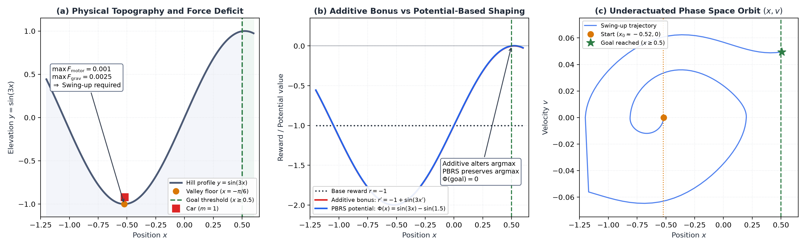
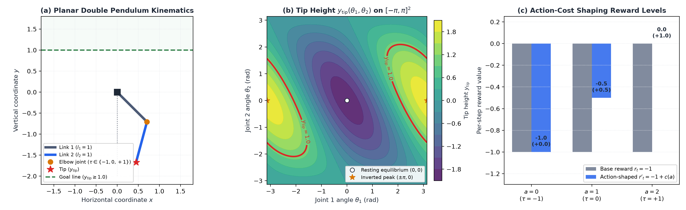
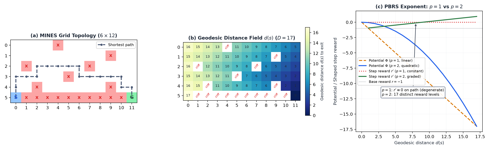
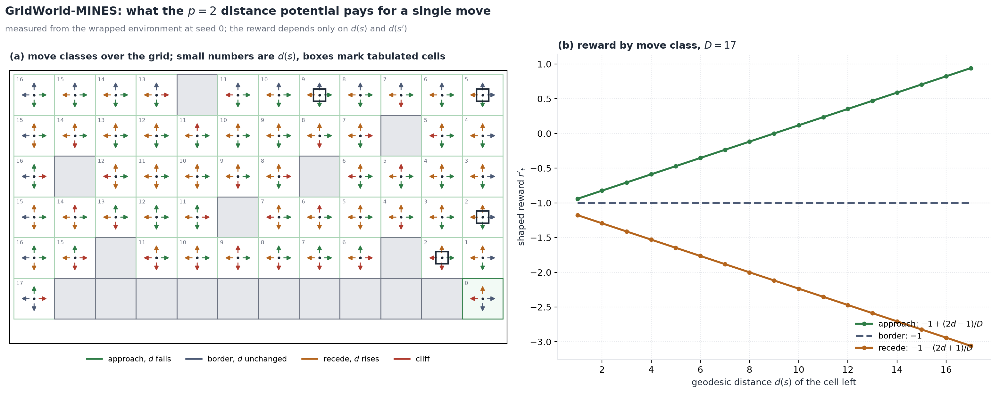
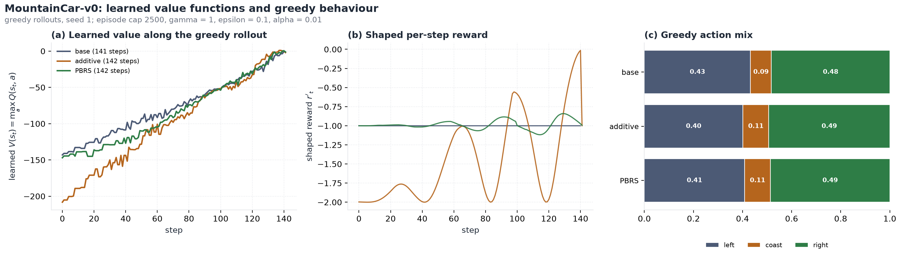
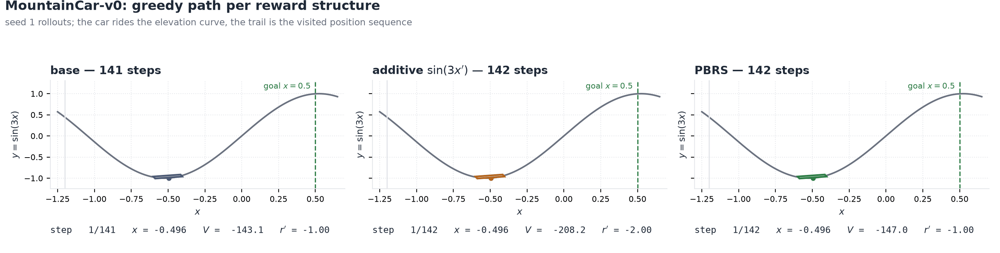
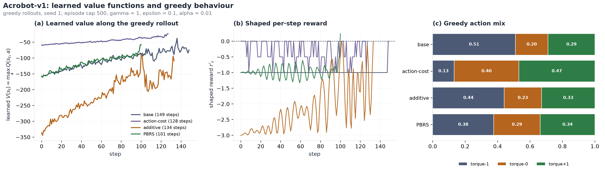
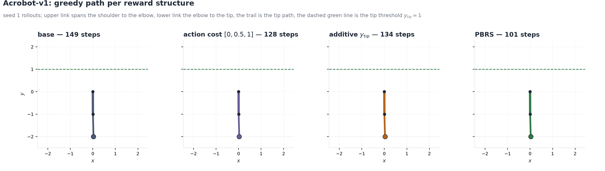
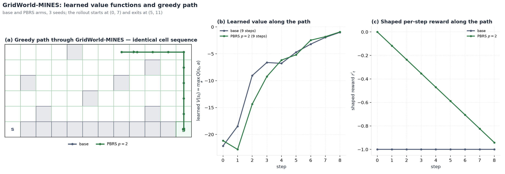
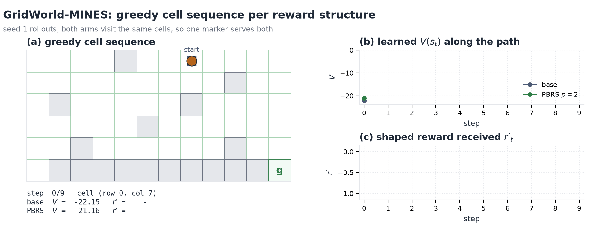

# Reward Shaping Mechanisms and Environment Dynamics in DR-MDP

This document details the physical models, equations of motion, and reward shaping mechanisms implemented across the research environments in `drmdp`.

---

## 1. Mathematical Foundations and Taxonomy

Delayed, Aggregate, and Anonymous Feedback (DAAF) withholds per-step rewards and delivers only the accumulated sum $Y_k = \sum_{t=t_k}^{t_{k+1}-1} r_t$ at delay window boundaries. When an environment provides a strictly constant step reward $r_t \equiv -1$, every window sum of length $L_k$ satisfies $Y_k = -L_k$. Under such feedback, reward estimation from features $\phi(s, a)$ reduces to fitting an uninformative level shift, making linear function approximation (LFA) estimation exact by construction.

To evaluate LFA reward estimation, environments require non-constant per-step reward functions that reflect state and action variations. Three classes of reward shaping wrappers are implemented in `src/drmdp/envs/wrappers.py` and registered in `src/drmdp/task.py`:

```
                    gym.Wrapper
                         |
        +----------------+----------------+
        |                                 |
AdditiveShapingWrapper         PotentialShapingWrapper
        |                                 |
  +-----+-----+                     +-----+-----+
  |           |                     |           |
MountainCar   Acrobot         MountainCar   Acrobot   GridWorld
HeightBonus   TipHeightBonus  HeightShaping TipHeight DistanceShaping
                                            Shaping
ActionCostShapingWrapper (standalone gym.Wrapper)
```

### 1.1 Potential-Based Reward Shaping (PBRS)

Implemented in `PotentialShapingWrapper(env, gamma, scale)`. Following Ng, Harada, and Russell (1999), the shaped reward $r'_t$ is defined as:

$$r'_t = r_t + \gamma \Phi(s_{t+1}) - \Phi(s_t)$$

where $\Phi: \mathcal{S} \to \mathbb{R}$ is a real-valued state potential function, $\gamma \in (0, 1]$ is the discount factor, and $r_t$ is the base reward.

- **Optimal Policy Invariance**: For any state-only potential $\Phi$, the action-value function transforms as $Q^*(s, a) = Q^*_{\mathrm{base}}(s, a) - \Phi(s)$. Because $\Phi(s)$ is independent of action $a$, the within-state action ordering and the optimal policy $\pi^*(s) = \arg\max_a Q^*(s, a)$ are strictly invariant for every scale and discount.
- **Telescoping Window Sums**: Over an un-truncated window of $L$ steps from $t$ to $t+L$, the sum of potential differences telescopes:
  $$\sum_{i=0}^{L-1} \gamma^i \left(\gamma \Phi(s_{t+i+1}) - \Phi(s_{t+i})\right) = \gamma^L \Phi(s_{t+L}) - \Phi(s_t)$$
  At $\gamma = 1$, the intermediate potentials cancel completely, leaving only the boundary potentials $\Phi(s_{t+L}) - \Phi(s_t)$.
- **Goal Referencing**: Subclasses define `goal_potential` such that $\Phi(s_{\mathrm{goal}}) = 0$. On terminating transitions ($s_{t+1} \in \mathcal{S}_{\mathrm{term}}$), the wrapper enforces $\Phi(s_{t+1}) = 0$, ensuring that the sum of shaping terms over an entire episode cancels to $-\Phi(s_0)$.

### 1.2 Additive State Bonus Shaping

Implemented in `AdditiveShapingWrapper(env, scale)`:

$$r'_t = r_t + \alpha \, b(s_{t+1})$$

where $b: \mathcal{S} \to \mathbb{R}$ is a state bonus function and $\alpha > 0$ is the scale factor.

- **Policy Modification**: Unlike PBRS, an additive bonus does not satisfy the potential difference condition. It directly modifies the Bellman optimality equation and shifts the greedy policy at $3\%\text{--}8\%$ of states.
- **Experimental Purpose**: Additive shaping creates strong, continuous state-dependent variation ($r'_t \in [-2, 0]$), providing a rigorous benchmark for tile-coding LFA estimators (`LeastLfaGenerativeRewardWrapper`, `BayesLeastLfaGenerativeRewardWrapper`).
- **Terminal Boundary Rule**: The bonus is omitted on terminal transitions ($s_{t+1} \in \mathcal{S}_{\mathrm{term}}$) to preserve the zero-reward terminal convention.

### 1.3 Action-Cost Shaping

Implemented in `ActionCostShapingWrapper(env, action_costs)`:

$$r'_t = r_t + c(a_t)$$

where $c: \mathcal{A} \to \mathbb{R}$ assigns a fixed scalar offset to each discrete action index.

- **Action Discrimination**: The reward depends solely on the chosen action $a_t$, independent of the continuous state vector.
- **Dimensionality Matching**: Any feature encoding with pure action discrimination (e.g., $1$-dimensional tiling with $d = |\mathcal{A}|$) can represent $c(a_t)$ with zero representation error.
- **Terminal Boundary Rule**: The action cost is omitted on terminal transitions.

---

## 2. MountainCar-v0



### 2.1 Physical Model and Equations of Motion

MountainCar-v0 models an underpowered car of mass $m = 1.0$ operating in a gravitational potential well defined by the sinusoidal elevation curve:

$$y(x) = \sin(3x), \qquad x \in [-1.2, 0.6]$$

The continuous state is $s = (x, v) \in [-1.2, 0.6] \times [-0.07, 0.07]$, representing position $x$ and velocity $v$. The discrete action $a \in \{0, 1, 2\}$ selects the horizontal motor force:

$$F(a) = (a - 1) \times 0.001 \in \{-0.001, 0.0, +0.001\}$$

The discrete-time equations of motion per time step $\Delta t = 1$ are:

$$v_{t+1} = \operatorname{clip}\left(v_t + F(a_t) - 0.0025 \cos(3 x_t), \, -0.07, \, 0.07\right)$$

$$x_{t+1} = \operatorname{clip}\left(x_t + v_{t+1}, \, -1.2, \, 0.6\right)$$

When $x_{t+1} = -1.2$ and $v_{t+1} < 0$, an inelastic collision with the left boundary resets $v_{t+1} \leftarrow 0$. The episode terminates when the position reaches the goal threshold:

$$x_{t+1} \geq 0.5$$

### 2.2 Mechanism of Underactuation

The gravitational slope force is:

$$F_{\mathrm{grav}}(x) = -0.0025 \cos(3x)$$

- Valley bottom: $x = -\frac{\pi}{6} \approx -0.5236$, where elevation is $y = -1.0$ and $F_{\mathrm{grav}} = 0$.
- Maximum slope: At $x = 0$, the gravitational force opposing rightward motion is $0.0025$.
- Motor force limit: $\max |F(a)| = 0.001$.

Because $\max |F(a)| = 0.001 < 0.0025$, the motor cannot accelerate the car out of the valley floor directly toward the goal from rest. The car must pump mechanical energy by driving left up the opposite hill, converting gravitational potential energy $U(x) = \sin(3x)$ into kinetic energy $K(v) = \frac{1}{2} v^2$ to overcome the crest at $x \geq 0.5$ (Figure 1c).

### 2.3 Base Reward

The base environment emits a constant step penalty:

$$r_t = -1.0 \qquad \forall t < T$$

### 2.4 Additive Height Bonus (`MountainCarHeightBonus`)

Registered under the identifier `"mountain-car-height"` in `task.REWARD_SHAPING_BUILDERS`:

$$r'_t = -1.0 + \alpha \sin(3 x_{t+1})$$

for non-terminal transitions, where $\alpha = 1.0$ by default.

- **Reward Support**: Because $\sin(3x) \in [-1.0, 1.0]$, the shaped reward spans $r'_t \in [-2.0, 0.0]$.
- **Incentive Structure**: The bonus rewards elevation directly. While intuitive, it penalizes moving left away from the goal to build momentum, shifting greedy action selections on $3\%\text{--}8\%$ of the state space.
- **Empirical Variance**: Along near-optimal trajectories, the per-step standard deviation is $\operatorname{sd}(r') \approx 0.62$.

### 2.5 Potential-Based Height Shaping (`MountainCarHeightShaping`)

Registered under `"mountain-car-height-pbrs"`:

$$\Phi(s) = \alpha \left(\sin(3x) - \sin(1.5)\right)$$

$$r'_t = -1.0 + \gamma \Phi(s_{t+1}) - \Phi(s_t)$$

- **Goal Reference**: Elevation at the goal $x = 0.5$ is $\sin(1.5) \approx 0.9975$. Subtracting $\sin(1.5)$ guarantees $\Phi(s_{\mathrm{goal}}) = 0$.
- **Potential Bounds**: For $x \in [-1.2, 0.6]$, $\Phi(s) \in [-1.9975, 0.0025]$.
- **Invariance**: Preserves the optimal policy exactly across all discounts $\gamma \in (0, 1]$ and scales $\alpha > 0$.

---

## 3. Acrobot-v1



### 3.1 Kinematics and Double Pendulum Dynamics

Acrobot-v1 models a planar, two-link double pendulum operating in a vertical plane under gravity ($g = 9.8$). Both links have length $l_1 = l_2 = 1.0$, mass $m_1 = m_2 = 1.0$, and moments of inertia $I_1 = I_2 = 1.0$.

The generalized coordinates are joint angles $(\theta_1, \theta_2)$:
- $\theta_1$: Angular displacement of link 1 relative to the downward vertical.
- $\theta_2$: Relative angular displacement of link 2 with respect to link 1.

The continuous state vector is $s = (\cos\theta_1, \sin\theta_1, \cos\theta_2, \sin\theta_2, \dot\theta_1, \dot\theta_2)$, with angular velocities bounded by $|\dot\theta_1| \leq 4\pi$ and $|\dot\theta_2| \leq 9\pi$.

The Cartesian positions of the joints are:
- Shoulder (fixed pivot): $(x_0, y_0) = (0, 0)$
- Elbow: $(x_1, y_1) = (\sin\theta_1, -\cos\theta_1)$
- Free Tip: $(x_{\mathrm{tip}}, y_{\mathrm{tip}}) = \left(\sin\theta_1 + \sin(\theta_1 + \theta_2), \, -\cos\theta_1 - \cos(\theta_1 + \theta_2)\right)$

The tip height is:

$$y_{\mathrm{tip}}(\theta_1, \theta_2) = -\cos\theta_1 - \cos(\theta_1 + \theta_2)$$

- Resting equilibrium: $(\theta_1, \theta_2) = (0, 0) \implies y_{\mathrm{tip}} = -2.0$.
- Inverted vertical: $(\theta_1, \theta_2) = (\pi, 0) \implies y_{\mathrm{tip}} = +2.0$.
- Goal condition: The episode terminates when the tip crosses above the horizontal threshold line:
  $$y_{\mathrm{tip}} \geq 1.0$$

### 3.2 Underactuation and Torque Actuation

The shoulder joint (connecting link 1 to the pivot) is unactuated. Torque $\tau \in \{-1.0, 0.0, +1.0\}$ is applied exclusively at the elbow joint via discrete action $a \in \{0, 1, 2\}$:

$$\tau(a) = a - 1.0$$

Equations of motion follow the coupled Lagrangian dynamics:

$$\mathbf{M}(\theta_2) \begin{bmatrix} \ddot\theta_1 \\ \ddot\theta_2 \end{bmatrix} + \mathbf{C}(\theta_1, \theta_2, \dot\theta_1, \dot\theta_2) \begin{bmatrix} \dot\theta_1 \\ \dot\theta_2 \end{bmatrix} + \mathbf{G}(\theta_1, \theta_2) = \begin{bmatrix} 0 \\ \tau \end{bmatrix}$$

Because joint 1 has zero direct torque, swinging link 2 induces reactionary torques on link 1 through the inertia matrix off-diagonal terms $M_{12}(\theta_2)$.

### 3.3 Base Reward

The base environment emits $r_t = -1.0$ on all non-terminal steps and $r_t = 0.0$ on the terminating step.

### 3.4 Action-Cost Shaping (`ActionCostShapingWrapper`)

Registered under `"action-cost"` in `task.REWARD_SHAPING_BUILDERS` and wired into `controlexps.py:595`:

$$r'_t = -1.0 + c(a_t)$$

with action cost vector $c = [0.0, 0.5, 1.0]$ for $a \in \{0, 1, 2\}$.

- **Reward Levels**:
  - $a = 0$ ($\tau = -1.0$): $r'_t = -1.0 + 0.0 = -1.0$
  - $a = 1$ ($\tau = 0.0$): $r'_t = -1.0 + 0.5 = -0.5$
  - $a = 2$ ($\tau = +1.0$): $r'_t = -1.0 + 1.0 = 0.0$
- **Properties**: The reward is state-independent and takes three discrete values (Figure 2c). A $3$-dimensional one-hot action encoding captures this reward function with zero approximation error.

### 3.5 Additive and Potential-Based Tip Height Shaping

- **Additive Tip Height Bonus** (`AcrobotTipHeightBonus`, `"acrobot-tip-height"`):
  $$r'_t = -1.0 + \alpha y_{\mathrm{tip}}(s_{t+1}) = -1.0 - \alpha \left(\cos\theta_{1, t+1} + \cos(\theta_{1, t+1} + \theta_{2, t+1})\right)$$
  for non-terminal steps. Bounded within $[-1.0 - 2\alpha, \, -1.0 + 2\alpha]$.
- **Potential-Based Tip Height Shaping** (`AcrobotTipHeightShaping`, `"acrobot-tip-height-pbrs"`):
  $$\Phi(s) = \alpha \left(y_{\mathrm{tip}}(s) - 1.0\right) = -\alpha \left(\cos\theta_1 + \cos(\theta_1 + \theta_2) + 1.0\right)$$
  $$r'_t = -1.0 + \gamma \Phi(s_{t+1}) - \Phi(s_t)$$
  with $\Phi(s_{\mathrm{term}}) = 0.0$. At all non-terminal states, $\Phi(s) \leq 0.0$.

---

## 4. GridWorld-MINES



### 4.1 Topology and Transition Dynamics

GridWorld-MINES (`controlexps.MINES_GW_GRID`) is a discrete $6 \times 12$ grid environment:

```
Row 0:  o o o o x o o o o o o o
Row 1:  o o o o o o o o o x o o
Row 2:  o x o o o o o x o o o o
Row 3:  o o o o o x o o o o o o
Row 4:  o o x o o o o o o x o o
Row 5:  s x x x x x x x x x x g
```

- Start cell: $s = (5, 0)$
- Goal/Exit cell: $g = (5, 11)$
- Cliff cells (`'x'`): Row 5 contains 10 consecutive cliff cells between start and exit. Seven additional cliff hazards are distributed across the interior.
- Actions: $a \in \{0, 1, 2, 3\}$ correspond to deterministic transitions $\{\mathrm{Up}, \mathrm{Right}, \mathrm{Down}, \mathrm{Left}\}$.

Attempting to walk right from start along row 5 triggers a cliff transition. Moving into any cliff cell incurs a reward penalty of $r_t = -100.0$ and respawns the agent at $(5, 0)$. Moving into an open cell incurs $r_t = -1.0$. Reaching the exit cell terminates the episode with reward $r_t = -1.0$.

### 4.2 Geodesic Distance Field $d(s)$

Let $d(s)$ denote the geodesic distance (minimum move count avoiding cliff cells) from cell $s$ to the exit $(5, 11)$, computed via breadth-first search on the non-cliff grid graph:

$$d(g) = 0, \qquad D = \max_{s \in \mathcal{S}_{\mathrm{passable}}} d(s) = 17$$

The start cell has distance $d((5, 0)) = 17$. Any shortest path must circumvent the bottom barrier by traversing through rows $0\text{--}4$ (Figure 3a, 3b).

### 4.3 Geodesic Potential-Based Shaping (`GridWorldDistanceShaping`)

Registered under `"gridworld-distance-pbrs"`:

$$\Phi(s) = -\alpha D \left(\frac{d(s)}{D}\right)^p$$

$$r'_t = r_t + \gamma \Phi(s_{t+1}) - \Phi(s_t)$$

where $\alpha > 0$ is the scale parameter and $p > 0$ is the distance exponent (default $p = 2.0$). Because $d(g) = 0$, $\Phi(g) = 0$, matching the terminal convention.

### 4.4 Analysis of Distance Exponents: Linear ($p=1$) vs Quadratic ($p=2$)

#### The Linear Degeneracy ($p = 1$)

When $p = 1$, the potential is linear in geodesic distance:

$$\Phi(s) = -\alpha \, d(s)$$

Along any optimal path, each step decreases distance by exactly one: $d(s_{t+1}) = d(s_t) - 1$. Under undiscounted evaluation ($\gamma = 1$):

$$r'_t = -1.0 + \Phi(s_{t+1}) - \Phi(s_t) = -1.0 - \alpha(d(s_t) - 1) - (-\alpha d(s_t)) = -1.0 + \alpha$$

For $\alpha = 1.0$, $r'_t \equiv 0.0$ on every step along the optimal trajectory. Thus, linear distance shaping collapses to a constant reward, failing the requirement of providing non-constant per-step signals for reward estimation.

#### The Quadratic Solution ($p = 2$)

When $p = 2$, the potential scales quadratically with distance:

$$\Phi(s) = -\frac{\alpha}{D} d(s)^2$$

For any step along a shortest path ($d(s_{t+1}) = d(s_t) - 1$):

$$\Phi(s_{t+1}) - \Phi(s_t) = -\frac{\alpha}{D} \left[(d(s_t) - 1)^2 - d(s_t)^2\right] = \frac{\alpha}{D} \left(2 d(s_t) - 1\right)$$

$$r'_t = -1.0 + \frac{\alpha}{D} \left(2 d(s_t) - 1\right)$$

Because $d(s_t)$ varies from $17$ down to $1$ along the path, $r'_t$ takes $17$ distinct, graded levels (Figure 3c): the bonus is largest far from the exit and smallest next to it, all while preserving exact argmax policy invariance.

### 4.5 Transition-Level Rewards and the Incentive to Approach the Exit

Because the potential depends on the state alone, the reward of a move is fixed by the distance of the cell left and of the cell entered:

$$r'_t = r_t + \gamma\Phi(s_{t+1}) - \Phi(s_t), \qquad \Phi(s) = -D\left(\frac{d(s)}{D}\right)^2 = -\frac{d(s)^2}{D}$$

With $\gamma = 1$, $D = 17$ and one move per step, every transition belongs to one of four classes:

| Move class | $d(s')$ | $r'_t$ |
| --- | --- | --- |
| approach | $d - 1$ | $-1 + (2d - 1)/D$ |
| border, agent stays | $d$ | $-1$ |
| recede | $d + 1$ | $-1 - (2d + 1)/D$ |
| cliff | teleport to $d = 17$ | $-100 - (D^2 - d^2)/D$ |



Measured from the wrapped environment at four cells, with the increment $r'_t - r_t$ in parentheses (seed 0; the boxes in panel (a) mark these cells):

| state | $d(s)$ | left | right | up | down |
| --- | --- | --- | --- | --- | --- |
| $(0, 7)$ | 9 | $(0, 6)$, $d = 10$: $-2.12$ $(-1.12)$ | $(0, 8)$, $d = 8$: $0.00$ $(+1.00)$ | border: $-1.00$ $(0.00)$ | $(1, 7)$, $d = 8$: $0.00$ $(+1.00)$ |
| $(0, 11)$ | 5 | $(0, 10)$, $d = 6$: $-1.65$ $(-0.65)$ | border: $-1.00$ $(0.00)$ | border: $-1.00$ $(0.00)$ | $(1, 11)$, $d = 4$: $-0.47$ $(+0.53)$ |
| $(3, 11)$ | 2 | $(3, 10)$, $d = 3$: $-1.29$ $(-0.29)$ | border: $-1.00$ $(0.00)$ | $(2, 11)$, $d = 3$: $-1.29$ $(-0.29)$ | $(4, 11)$, $d = 1$: $-0.82$ $(+0.18)$ |
| $(4, 10)$ | 2 | cliff: $-116.76$ $(-16.76)$ | $(4, 11)$, $d = 1$: $-0.82$ $(+0.18)$ | $(3, 10)$, $d = 3$: $-1.29$ $(-0.29)$ | cliff: $-116.76$ $(-16.76)$ |

All sixteen transitions equal the class formula to machine precision; the measurement script asserts the equality instead of tabulating a model. Measured rewards by move class:

| $d(s)$ | approach | border | recede | cliff |
| --- | --- | --- | --- | --- |
| 17 | $+0.941$ | $-1.000$ | $-3.059$ | $-100.00$ |
| 13 | $+0.471$ | $-1.000$ | $-2.588$ | $-107.06$ |
| 9 | $0.000$ | $-1.000$ | $-2.118$ | $-112.24$ |
| 5 | $-0.471$ | $-1.000$ | $-1.647$ | $-115.53$ |
| 2 | $-0.824$ | $-1.000$ | $-1.294$ | $-116.76$ |
| 1 | $-0.941$ | $-1.000$ | $-1.176$ | $-116.94$ |

Three properties follow from the class formulas:

- **Ordering within a state.** Approach pays $(2d - 1)/D$ above the base step and receding pays $(2d + 1)/D$ below it, so approach > border > recede at every distance, and the gap between approach and recede is $4d/D$: $2.12$ at $d = 9$ and $0.47$ at $d = 2$. Every cell therefore offers a strict preference for reducing $d$, and none among the moves that reduce it equally — at $(0, 7)$ moving right and moving down both pay $0.00$.
- **No arbitrage.** Receding costs exactly what approaching gains plus two base steps: leaving $d$ and returning cancels to $-2$. Summed over an episode, the increments telescope to $G' = -T - \Phi(s_0)$, a function of the episode length $T$ alone. The shaping therefore adds no reason to approach the exit beyond the $-1$ per step; what it changes is the per-step signal, which is the property §1 relies on for estimation. The greedy cell sequence in §5.3 is the base arm's.
- **Only the level falls with $d$.** The approach reward crosses zero at $d = D/2 = 8.5$: a step taken at $d = 17$ pays $+0.94$ and a step at $d = 1$ pays $-0.94$, still above the base $-1$. Cliffs dominate every move: $-100$ less $(D^2 - d^2)/D$, and exactly $-100$ when the agent already stands at $d = 17$, because the teleport target is the cell the environment was constructed with.

---

## 5. Learned Value Functions and Greedy Behaviour per Reward Structure
Sections 2–4 specify the reward each mechanism pays. This section measures the value function that a semi-gradient agent learns from that reward, and the greedy behaviour that the value function induces.

**Protocol.** One agent per (environment, structure) arm: semi-gradient SARSA with linear function approximation on tile-coded observation-action features (`tile-observation-action-ft`, tiling dimension $4$ for MountainCar, $3$ for Acrobot and $5$ for GridWorld; the Acrobot dictionary exceeds $8192$ cells and is hashed to that width), $\gamma = 1$, $\varepsilon = 0.1$, constant step size $\alpha = 0.01$, $1200$ episodes, $3$ seeds. Training observes $r'_t$ at every step, without DAAF windowing, so reward-estimation error is excluded and the comparison isolates the reward structure. Each trained policy is then rolled out greedily from one shared start state (evaluation seed $1000$, identical across arms and seeds, which matters for GridWorld-MINES because its reset samples a start cell), bounded by the environment time limit ($2500$, $500$, $200$ steps).

**Quantities.** $G = \sum_{t=0}^{T-1} r'_t$ is the realized undiscounted return of the greedy rollout, $V(s_0) = \max_a Q(s_0, a)$ the learned value at the start state, *steps* the transition count to the goal condition, and *modal action* the most frequent action with its share of the rollout in parentheses. Table entries are medians across seeds with the seed range in brackets.

### 5.1 MountainCar-v0





The animation replays the recorded position sequence of each arm's greedy rollout (seed 1): the car on the elevation curve, the visited positions as a trail, and the learned value and shaped reward at the current step. The three rollouts take $141$, $142$ and $142$ steps, all run from $x = -1.20$ to $x \in [0.50, 0.52]$, reverse velocity five times each, and travel $4.06$, $3.92$ and $3.65$ units horizontally. The reward structure changes the value scale and the per-step reward, not the shape of the motion.

| Structure | steps to $x \geq 0.5$ | $V(s_0)$ | $G$ | modal action (share, per seed) | $r'$ levels (seed 1) |
| --- | --- | --- | --- | --- | --- |
| base | 141 [137, 154] | -145.6 [-146.0, -143.1] | -141.0 [-154.0, -137.0] | right (0.48), left (0.48), right (0.53) | 1 |
| additive $\sin(3x')$ | 142 [138, 148] | -208.2 [-208.8, -207.2] | -207.5 [-209.8, -204.3] | right (0.49, 0.46, 0.46) | 142 |
| PBRS | 136 [106, 142] | -144.3 [-147.0, -143.3] | -134.0 [-140.0, -104.0] | right (0.49, 0.63, 0.51) | 141 |

- **Base.** The constant reward gives one reward level, $G = -T$, and a value profile that rises from $V(s_0) = -145.6$ to $V(s_T) \in [-2.2, 6.9]$ along the path (Figure 4a). The action mix is split between left ($0.43$) and right ($0.48$) at seed 1 (Figure 4c): the goal requires the leftward excursion that precedes the climb (§2.2), so neither direction dominates.
- **Additive.** $V(s_0) = -208.2$, $1.43$ times the base magnitude, while the trajectory length is unchanged ($142$ against $141$ steps) and the action mix is unchanged within $0.03$ per action (Figure 4c). The $142$ transitions of the additive rollout pay $-207.5$ where the base reward would have paid $-142$: the bonus $\sin(3x')$ is negative over the leftward phase, so the shaping charges $65.5$ for the behaviour the task requires (mean $-1.46$ per step against $-1.00$). The incentive is an elevation term, applied step by step, that conflicts with momentum building; it inflates $|V|$ without shortening the path.
- **PBRS.** $V(s_0) = -144.3$, within $0.9\%$ of the base value, and the shortest median path of the three ($136$ steps). At seed 1 the $142$-step rollout pays $-142 + 1.99 = -140.01$, equal to the recorded $G = -140.01$: the potential offset $-\Phi(s_0) = \sin(1.5) - \sin(3x_0) = 1.99$ is exactly what the telescoping sum of §1.1 predicts. The incentive is a per-episode constant rather than a per-step preference, which leaves the action ordering intact and accounts for the unchanged action mix (left $0.41$, coast $0.11$, right $0.49$).
- **Value against return.** The learned $V(s_0)$ lies below the realized return of the greedy rollout by $2.1$ (base), $0.7$ (additive) and $10.2$ (PBRS) at the median, so the estimate is pessimistic in each case. The gap has two known sources, not separated here: $V$ is estimated under the $\varepsilon$-greedy behaviour distribution while the rollout is greedy, and the estimate is not converged at $1200$ episodes.

### 5.2 Acrobot-v1





The animation replays each arm's greedy rollout (seed 1) as a two-link schematic with the tip trail against the tip threshold. The paths differ in cost as well as length: total tip travel is $31.8$ units for PBRS over $101$ steps, $33.0$ for action cost over $128$, $57.0$ for base over $149$ and $67.3$ for additive over $134$. Every arm spends $87\text{--}98\%$ of its steps with the tip below $y_{\mathrm{tip}} = 0$, so the arms differ in how much swinging the climb costs rather than in where they start.

| Structure | steps to $y_{\mathrm{tip}} \geq 1$ | $V(s_0)$ | $G$ | modal action (share, per seed) | $r'$ levels (seed 1) |
| --- | --- | --- | --- | --- | --- |
| base | 149 [109, 176] | -158.1 [-158.8, -152.3] | -148.0 [-175.0, -108.0] | torque-1 (0.51), torque-1 (0.36), torque-0 (0.37) | 2 |
| action cost $[0, 0.5, 1]$ | 128 [110, 234] | -58.7 [-59.1, -52.3] | -42.5 [-78.0, -40.0] | torque+1 (0.47, 0.49, 0.52) | 3 |
| additive $y_{\mathrm{tip}}$ | 134 [127, 148] | -308.0 [-336.1, -292.3] | -276.5 [-284.1, -269.9] | torque-1 (0.44), torque+1 (0.36), torque-1 (0.43) | 134 |
| PBRS | 177 [101, 299] | -153.2 [-157.3, -150.5] | -173.0 [-295.0, -97.0] | torque-1 (0.38), torque+1 (0.39), torque-0 (0.34) | 101 |

- **Base.** Two reward levels ($-1$ per step, $0$ on the terminating transition) and no dominant action: the modal action changes with the seed between torque-1 (share $0.51$ and $0.36$) and torque-0 ($0.37$). The tip crosses $y_{\mathrm{tip}} \geq 1$ after $149$ steps at the median, and the learned $V(s_0) = -158.1$ lies below the realized $G = -148.0$.
- **Action cost.** The modal action is torque$+1$ in $3/3$ seeds at share $0.47$–$0.52$, the action whose shaped reward is $0$ (§3.4). At seed 1 the torque-1 share falls from $0.51$ to $0.13$ and torque-0 rises from $0.20$ to $0.40$ (Figure 5c): a state-independent action offset reprices actions and thereby changes the greedy policy, unlike a state potential. $V(s_0) = -58.7$, $0.37$ of the base magnitude, because every step is paid at least $-1$ and at most $0$.
- **Additive.** $V(s_0) = -308.0$, $1.95$ times the base magnitude, with a shorter median path ($134$ against $149$ steps). At seed 1 the $134$-step rollout pays $-284.1$ against $-133$ under the base reward, a mean of $-2.12$ per step against $-0.99$: the tip-height bonus is negative over most of the swing-up and charges $151.1$ for it, so the value scale doubles while the incentive to reach the threshold remains.
- **PBRS.** $V(s_0) = -153.2$, $3.1\%$ smaller in magnitude than the base value, against the $95\%$ increase that the additive bonus produces, and the widest seed spread of any arm: steps span $101$ to $299$ while $V(s_0)$ spans $-157.3$ to $-150.5$. At seed 1 the $101$-step rollout pays $-100 + 3.00 = -97.00$, equal to the recorded $G$: $-\Phi(s_0) = 1.0 - y_{\mathrm{tip}}(s_0) = 3.00$ exactly. The incentive is again a per-episode constant, so the sign of every action's advantage is preserved and the value scale stays at baseline.

### 5.3 GridWorld-MINES



| Structure | steps to exit | $V(s_0)$ | $G$ | modal action (share, per seed) | $r'$ levels (seed 1) |
| --- | --- | --- | --- | --- | --- |
| base | 9 [9, 9] | -21.0 [-22.1, -17.6] | -9.00 [-9.00, -9.00] | down (0.56, 0.56, 0.56) | 1 |
| PBRS $p = 2$ | 9 [9, 9] | -12.1 [-21.2, -11.9] | -4.24 [-4.24, -4.24] | down (0.56, 0.56, 0.56) | 9 |



The animation walks the cell sequence once. Both arms visit the same cells, so a single marker serves both; the panels on the right accumulate each arm's learned value and received reward. In panel (c) the PBRS curve lies above the base line at every step, and the gap between them narrows monotonically from $1.00$ to $0.06$ as the exit is approached.

- **Path.** Both arms and all three seeds produce one cell sequence: four moves right along row $0$ from $(0, 7)$ to $(0, 11)$, then five moves down to the exit $(5, 11)$ — $9$ transitions through $10$ distinct cells, with no cliff entry. The geodesic distance of the rollout start is $d((0, 7)) = 9$, equal to the Manhattan lower bound for that pair of cells, so the greedy sequence is a shortest path (§4.2). The rollout start is the cell that `RandomStartGridWorld` samples at the evaluation seed, not the nominal `s` cell $(5, 0)$ of §4.1, whose distance is $17$.
- **Base.** $V(s_0) = -21.0$ against $G = -9.00$: the learned value overstates the realized cost by $12$ while the policy is optimal, which reflects the $\varepsilon$-greedy behaviour distribution used during training.
- **PBRS.** $V(s_0) = -12.1$ and $G = -4.24 = -9.00 - \Phi(s_0)$ with $-\Phi(s_0) = D\,(d/D)^2 = 81/17 = 4.76$. The shaped reward along the path is $0.00, -0.12, -0.24, \ldots, -0.94$: $9$ levels, matching $r'_t = -1 + (2d(s_t) - 1)/17$ from §4.4, highest at the step leaving $d = 9$ and lowest on the step entering the exit. The per-step reward therefore falls as the agent approaches the exit, and every step of this path still pays at least the base $-1$, because $d \leq 9$ throughout. Panel (c) of Figure 6 plots that total received reward, not the shaping increment: the increment $\Phi(s_{t+1}) - \Phi(s_t) = (2d(s_t) - 1)/17$ falls from $+1.00$ to $+0.059$ while the base term stays at $-1$, so the received reward stays above the base reward on every step of this path, with the gap narrowing from $1.00$ to $0.06$. The comparison that carries the incentive is within a state: at $d = 9$ the move that reduces $d$ pays $0.00$ and the move that increases it pays $-2.12$. The return gain $4.76$ comes entirely from the potential offset rather than from a per-step preference for cells near the exit.

#### Per-cell value tables

The bullets above compare the arms at $s_0$ and along one trajectory. The tables below evaluate the learned $V(s) = \max_a Q(s, a)$ at all $54$ live cells, median over the three training seeds, from `agents/output/2026-11-08-gw-per-cell-values.py` under the protocol of this section ($1200$ episodes, tile-coded observation-action features at `tiling_dim` $5$, $\gamma = 1$, $\varepsilon = 0.1$).

$V(s)$, base arm:

| | c0 | c1 | c2 | c3 | c4 | c5 | c6 | c7 | c8 | c9 | c10 | c11 |
| --- | --- | --- | --- | --- | --- | --- | --- | --- | --- | --- | --- | --- |
| r0 | -39.8 | -39.8 | -34.7 | -32.3 | x | -25.8 | -24.9 | -21.0 | -16.8 | -10.1 | -6.7 | -6.8 |
| r1 | -37.6 | -34.7 | -30.4 | -28.4 | -28.5 | -28.4 | -27.9 | -27.1 | -23.4 | x | -4.1 | -4.9 |
| r2 | -38.3 | x | -32.5 | -29.5 | -30.4 | -30.4 | -27.2 | x | -14.4 | -10.7 | -4.4 | -3.8 |
| r3 | -39.5 | -42.6 | -31.7 | -29.9 | -35.3 | x | -22.0 | -10.3 | -6.9 | -5.6 | -3.0 | -2.0 |
| r4 | -41.5 | -45.6 | x | -29.0 | -29.0 | -24.8 | -21.7 | -17.5 | -9.5 | x | -1.2 | -1.0 |
| r5 | -43.4 | x | x | x | x | x | x | x | x | x | x | -17.5 |

$V(s)$, PBRS $p = 2$ arm:

| | c0 | c1 | c2 | c3 | c4 | c5 | c6 | c7 | c8 | c9 | c10 | c11 |
| --- | --- | --- | --- | --- | --- | --- | --- | --- | --- | --- | --- | --- |
| r0 | -27.6 | -29.5 | -26.0 | -25.2 | x | -16.3 | -12.5 | -12.1 | -13.4 | -9.1 | -7.0 | -5.9 |
| r1 | -26.8 | -27.7 | -31.0 | -28.7 | -19.5 | -18.4 | -16.0 | -17.1 | -14.8 | x | -3.5 | -5.2 |
| r2 | -26.1 | x | -32.9 | -26.2 | -30.2 | -26.3 | -25.9 | x | -11.4 | -7.5 | -3.3 | -3.1 |
| r3 | -28.2 | -23.2 | -21.0 | -20.8 | -20.5 | x | -18.2 | -7.7 | -6.1 | -4.7 | -2.4 | -1.8 |
| r4 | -33.0 | -38.6 | x | -19.7 | -17.8 | -15.4 | -14.8 | -12.5 | -3.1 | x | -2.9 | -0.9 |
| r5 | -33.6 | x | x | x | x | x | x | x | x | x | x | -14.5 |

$\Delta V = V_{\mathrm{pbrs}} - V_{\mathrm{base}}$ (median over seeds) beside $-\Phi(s) = d(s)^2/D$, the shift §1.1 predicts:

| | c0 | c1 | c2 | c3 | c4 | c5 | c6 | c7 | c8 | c9 | c10 | c11 |
| --- | --- | --- | --- | --- | --- | --- | --- | --- | --- | --- | --- | --- |
| r0 | +12.3 / 15.06 | +10.3 / 13.24 | +8.7 / 11.53 | +7.0 / 9.94 | x | +9.5 / 7.12 | +12.4 / 5.88 | +8.9 / 4.76 | +3.3 / 3.76 | +1.0 / 2.88 | -0.3 / 2.12 | +0.9 / 1.47 |
| r1 | +10.8 / 13.24 | +7.0 / 11.53 | -0.6 / 9.94 | -0.3 / 8.47 | +9.0 / 7.12 | +10.0 / 5.88 | +11.9 / 4.76 | +10.1 / 3.76 | +8.5 / 2.88 | x | +0.6 / 1.47 | -0.3 / 0.94 |
| r2 | +12.2 / 15.06 | x | -0.4 / 8.47 | +3.3 / 7.12 | +0.2 / 5.88 | +4.1 / 4.76 | +1.3 / 3.76 | x | +3.0 / 2.12 | +3.2 / 1.47 | +1.2 / 0.94 | +0.7 / 0.53 |
| r3 | +11.3 / 13.24 | +19.4 / 11.53 | +10.7 / 9.94 | +9.0 / 8.47 | +14.7 / 7.12 | x | +3.8 / 2.88 | +2.7 / 2.12 | +0.9 / 1.47 | +0.9 / 0.94 | +0.6 / 0.53 | +0.2 / 0.24 |
| r4 | +8.6 / 15.06 | +7.0 / 13.24 | x | +9.3 / 7.12 | +11.2 / 5.88 | +9.4 / 4.76 | +6.9 / 3.76 | +5.1 / 2.88 | +6.4 / 2.12 | x | -1.6 / 0.24 | +0.1 / 0.06 |
| r5 | +9.8 / 17.00 | x | x | x | x | x | x | x | x | x | x | +2.9 / -0.00 |

| $d(s)$ | cells | $-\Phi(s)$ | mean $V_{\mathrm{base}}$ | mean $V_{\mathrm{pbrs}}$ | mean $\Delta V$ | mean $\lvert \Delta V + \Phi \rvert$ |
| --- | --- | --- | --- | --- | --- | --- |
| 1 | 1 | 0.06 | -1.00 | -0.93 | +0.07 | 0.01 |
| 2 | 2 | 0.24 | -1.62 | -2.33 | -0.70 | 0.94 |
| 3 | 2 | 0.53 | -3.40 | -2.75 | +0.65 | 0.12 |
| 4 | 3 | 0.94 | -4.98 | -4.37 | +0.61 | 0.49 |
| 5 | 4 | 1.47 | -7.12 | -5.73 | +1.39 | 0.94 |
| 6 | 4 | 2.12 | -10.23 | -7.29 | +2.94 | 2.01 |
| 7 | 4 | 2.88 | -18.24 | -13.64 | +4.60 | 2.64 |
| 8 | 4 | 3.76 | -23.19 | -17.78 | +5.40 | 3.08 |
| 9 | 4 | 4.76 | -26.02 | -17.42 | +8.59 | 4.15 |
| 10 | 4 | 5.88 | -28.16 | -19.71 | +8.45 | 5.41 |
| 11 | 5 | 7.12 | -29.62 | -20.45 | +9.17 | 3.57 |
| 12 | 3 | 8.47 | -30.29 | -27.49 | +2.79 | 6.06 |
| 13 | 3 | 9.94 | -31.45 | -25.74 | +5.71 | 4.72 |
| 14 | 3 | 11.53 | -37.34 | -25.65 | +11.69 | 5.07 |
| 15 | 4 | 13.24 | -40.63 | -30.77 | +9.87 | 3.37 |
| 16 | 3 | 15.06 | -39.89 | -28.88 | +11.01 | 4.05 |
| 17 | 1 | 17.00 | -43.35 | -33.59 | +9.76 | 7.24 |

- **Both arms value a cell by its distance to the exit.** The per-distance means run from $-1.00$ at $d = 1$ to $-43.35$ at $d = 17$ under the base reward and from $-0.93$ to $-33.59$ under PBRS, with a spread within each distance band: at $d = 12$ the three cells $(1, 3)$, $(2, 2)$ and $(3, 3)$ carry $-28.4$, $-32.5$ and $-29.9$ in the base grid.
- **The aggregate shift matches the potential; the cell-by-cell shift does not resolve.** The mean $\Delta V$ over the $54$ cells is $+5.85$ against a predicted mean of $6.08$, and $\operatorname{corr}(\Delta V, -\Phi) = +0.62$. The per-cell deviation averages $3.24$ and reaches $10.50$, against an average within-arm seed spread of $4.61$ (base) and $8.97$ (PBRS) over the same cells: an individual entry of the $\Delta V$ grid is not separated from training noise. §5.4 reaches $\Delta V = -0.85$ and correlation $-0.48$ from one seed and the $10$ trajectory states, a sign difference that is consistent with that noise level and not with a resolved shift.
- **The greedy action agrees at $49$ of $54$ cells.** The five cells that differ are $(2, 2)$ up to right, $(2, 4)$ right to up, $(3, 0)$ up to right, $(3, 4)$ up to down and $(4, 1)$ up to left (base to PBRS). The comparison is between modal actions over three seeds, so one seed can move an entry: four of the five sit at $d \geq 11$ and the fifth at $d = 10$, where the seed spread is of the same order as the per-cell shift (previous bullet).
- **The exit cell is not a fitted value.** The agent never occupies $(5, 11)$ as a pre-action observation, because the episode terminates on entry, so the tile features give that cell no training target; both arms report $V \approx -15$ there against about $-1$ at $d = 1$. That entry is interpolation, not estimate.

### 5.4 Comparison Across Structures

**Value shift against the PBRS prediction.** For a state potential, §1.1 predicts $Q_{\mathrm{pbrs}}(s, a) = Q_{\mathrm{base}}(s, a) - \Phi(s)$. The table evaluates that prediction on the states visited by the base arm's greedy trajectory, at seed 1, with $\Delta V(s) = V_{\mathrm{pbrs}}(s) - V_{\mathrm{base}}(s)$:

| Structure | states | mean $\Delta V$ | mean $-\Phi(s)$ | mean $\lvert \Delta V + \Phi \rvert$ | max $\lvert \Delta V + \Phi \rvert$ | $\operatorname{corr}(\Delta V, -\Phi)$ |
| --- | --- | --- | --- | --- | --- | --- |
| mc-pbrs | 142 | -0.34 | 1.44 | 3.49 | 8.40 | -0.25 |
| acrobot-pbrs | 150 | 1.35 | 2.12 | 4.35 | 17.58 | -0.11 |
| gw-pbrs-p2 | 10 | -0.85 | 1.68 | 2.91 | 8.20 | -0.48 |

The shift is not recovered: the mean absolute deviation from $-\Phi$ exceeds the mean predicted shift in all three environments, and the correlation between the measured and predicted shifts is negative in all three. At $1200$ episodes with $\varepsilon = 0.1$, both value functions carry approximation error of the same order as the shift itself. The exact statement survives at the level of returns, where it holds to rounding: $-142 + 1.99 = -140.01$ (MountainCar), $-100 + 3.00 = -97.00$ (Acrobot) and $-9.00 + 4.76 = -4.24$ (GridWorld) all equal the recorded $G$. Shaping changes the realized return of a fixed policy by exactly $-\Phi(s_0)$; it does not change the learned value by the same amount at this budget. The per-cell tables of §5.3 read the same conclusion from a larger sample ($54$ cells, median over three seeds): mean $\Delta V = +5.85$ against a predicted $6.08$, per-cell deviation averaging $3.24$ against within-arm seed spreads of $4.61$ (base) and $8.97$ (PBRS), and $\operatorname{corr}(\Delta V, -\Phi) = +0.62$. The sign of the mean shift differs between the two measurements, which is the finding: neither the sign nor the magnitude of a per-cell shift is separable from training noise at $1200$ episodes.

**Spread across seeds.** Identical rewards and identical trajectories in GridWorld give a direct reading of training noise: $V(s_0)$ varies over a range of $4.55$ (base) and $9.26$ (PBRS) across three seeds while the greedy path and return do not vary at all. Spreads below roughly $10$ in absolute value are therefore not separable from seed noise in these runs.

| Structure | steps | spread in steps | spread in $V(s_0)$ | spread in $G$ |
| --- | --- | --- | --- | --- |
| mc-base | 141 | 17 (12%) | 2.88 | 17.00 |
| mc-additive | 142 | 10 (7%) | 1.59 | 5.55 |
| mc-pbrs | 136 | 36 (26%) | 3.65 | 36.00 |
| acrobot-base | 149 | 67 (45%) | 6.44 | 67.00 |
| acrobot-action-cost | 128 | 124 (97%) | 6.82 | 38.00 |
| acrobot-additive | 134 | 21 (16%) | 43.75 | 14.17 |
| acrobot-pbrs | 177 | 198 (112%) | 6.80 | 198.00 |
| gw-base | 9 | 0 | 4.55 | 0.00 |
| gw-pbrs-p2 | 9 | 0 | 9.26 | 0.00 |

Two patterns follow. The non-potential structures move $|V(s_0)|$ by amounts well above the noise range: $62.6$ for the MountainCar additive bonus, $149.9$ for the Acrobot additive bonus, and $99.4$ for the Acrobot action cost, matching their per-step reward changes rather than any change in path length. The potential-based structures leave $V(s_0)$ within the noise range of the base arm in all three environments, which is consistent with policy invariance but does not establish it at this budget. In six of the nine arms the spread in $V(s_0)$ is smaller than the spread in realized return, so a small value difference is not evidence about trajectory quality. The exceptions are the Acrobot additive arm, where the value spread ($43.75$) exceeds the return spread ($14.17$), and the two GridWorld arms, where the return does not vary at all.

---

## 6. Environment Shaping Configuration Matrix

The table below summarizes the configuration and registration of shaping mechanisms across the codebase:

| Environment | Shaping Key | Wrapper Class | Formulation | Reward Support | Policy Invariant |
|---|---|---|---|---|---|
| **MountainCar-v0** | `"mountain-car-height"` | `MountainCarHeightBonus` | $r' = -1 + \sin(3x')$ | $[-2.0, 0.0]$ | No (alters $3\%\text{--}8\%$) |
| **MountainCar-v0** | `"mountain-car-height-pbrs"` | `MountainCarHeightShaping` | $r' = -1 + \gamma\Phi(s') - \Phi(s)$ | $[-2.0, 0.0]$ | **Yes** ($\Phi = \sin(3x) - \sin(1.5)$) |
| **Acrobot-v1** | `"action-cost"` | `ActionCostShapingWrapper` | $r' = -1 + c(a)$ | $\{-1.0, -0.5, 0.0\}$ | Modifies cost |
| **Acrobot-v1** | `"acrobot-tip-height"` | `AcrobotTipHeightBonus` | $r' = -1 + y_{\mathrm{tip}}(s')$ | $[-3.0, 1.0]$ | No |
| **Acrobot-v1** | `"acrobot-tip-height-pbrs"` | `AcrobotTipHeightShaping` | $r' = -1 + \gamma\Phi(s') - \Phi(s)$ | Variable | **Yes** ($\Phi = y_{\mathrm{tip}} - 1.0$) |
| **GridWorld-MINES** | `"gridworld-distance-pbrs"` | `GridWorldDistanceShaping` | $r' = r + \gamma\Phi(s') - \Phi(s)$ | 17 levels ($p=2$) | **Yes** ($\Phi = -D(d/D)^p$) |

---

## 7. Verification and Reproducibility

### 7.1 Illustration figures

The illustration figures in `docs/figures/` and `agents/analyses/figures/` are programmatically generated by `agents/output/generate_shaping_illustrations.py` and can be regenerated via:

```sh
uv run --no-project --with matplotlib python agents/output/generate_shaping_illustrations.py
```

The transition-level figure and the tables of §4.5 come from `agents/output/2026-11-08-gw-transition-rewards.py`, which queries the wrapped environment for every action at the tabulated cells and exits non-zero when a measured reward differs from the potential prediction:

```sh
uv run --no-project --with matplotlib python agents/output/2026-11-08-gw-transition-rewards.py
```

### 7.2 Learned value functions

The figures and tables of §5 are regenerated end to end by:

```sh
agents/output/2026-11-08-learned-value-functions-per-reward-structure.sh
```

The driver trains one chunk per environment under `agents/output/.chunks/`, merges the chunks into `agents/output/2026-11-08-learned-value-functions-per-reward-structure.json`, renders `docs/figures/{mountaincar,acrobot,gridworld}-learned-values.png` and the three `*-greedy-paths.gif` animations from that file, and fails when a stored rollout lacks per-step value, reward or action traces of the rollout length, or when a table or figure predates the results file. Finished chunks are reused, so an interrupted invocation resumes; `FORCE=1` retrains every arm. Episode count, seed count, evaluation seed and the step size are the defaults of that script ($1200$ episodes, $3$ seeds, evaluation seed $1000$, $\alpha = 0.01$, $\varepsilon = 0.1$, $\gamma = 1$), and the stored JSON is the source for every number quoted in §5.
